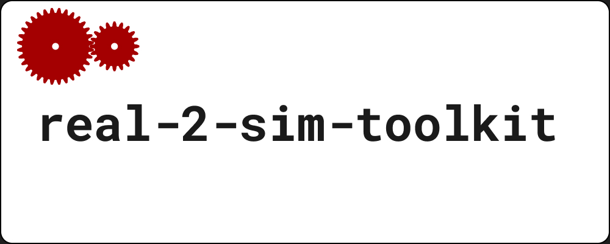
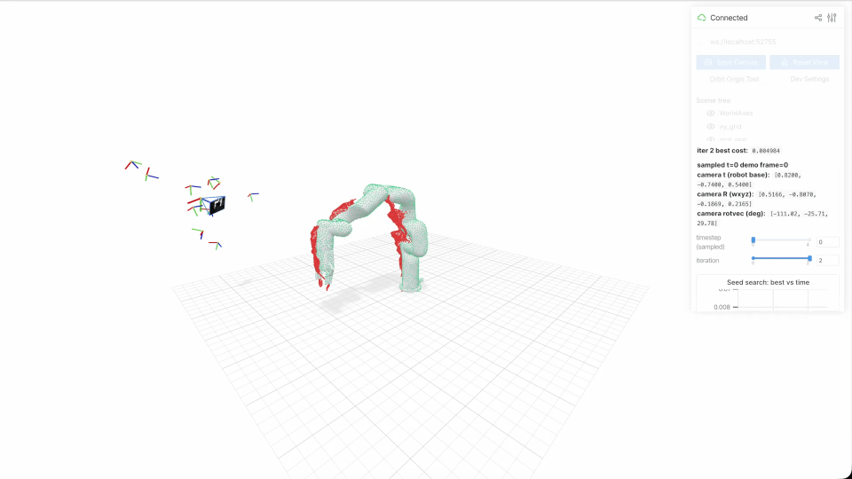
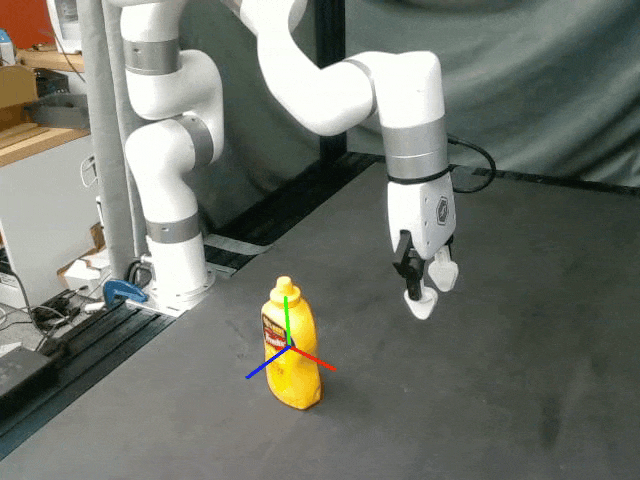

# Real2sim_toolkit



This repository is an API for creating and maintaining a digital twin of a physical environment.

## Installation

```bash
# Download FoundationPose weights
gcloud storage cp --recursive gs://r2st-public/2024-01-11-20-02-45 src/r2st/FoundationPose/weights/
gcloud storage cp --recursive gs://r2st-public/2023-10-28-18-33-37 src/r2st/FoundationPose/weights/

# Set your Meshy and OpenAI API keys (recommend adding to ~/.bashrc)
export MESHY_API_KEY=your_meshy_api_key
export OPENAI_API_KEY=your_openai_api_key

# Clone this repo with submodules (`git clone --recurse-submodules ...`), or init them after clone:
git submodule update --init src/r2st/sam3

# Clone ManiSkill and Jrl2 (required before `uv sync`)
git clone git@github.com:jstmn/ManiSkill.git thirdparty/ManiSkill
git clone git@github.com:jstmn/Jrl2.git thirdparty/Jrl2

# SAM 3 checkpoints are gated. Request access at https://huggingface.co/facebook/sam3
# then authenticate after `uv sync` (which installs the local `src/r2st/sam3` package):

# Initialize uv
uv sync
uv run hf auth login

# REQUIRED: Get sam3 access at https://huggingface.co/facebook/sam3

# S2M2 stereo depth checkpoints (S/M/L/XL = CH128NTR1/CH192NTR2/CH256NTR3/CH384NTR3)
uv run hf download minimok/s2m2 CH256NTR3.pth --local-dir src/r2st/S2M2/weights/pretrain_weights

# Build and start the FoundationPose docker container (docker installation steps at https://docs.docker.com/engine/install/ubuntu/). Note that you need `nvidia-container-toolkit` installed as well (https://docs.nvidia.com/datacenter/cloud-native/container-toolkit/latest/install-guide.html)
# The image is built locally (not pulled) because it's built on CUDA 12.8 + PyTorch 2.8 to support
# current-gen GPUs (e.g. RTX 50-series/Blackwell). That covers GPU *architectures* back through
# sm_70; the host NVIDIA *driver* still needs to be new enough for CUDA 12.8 (Linux driver >= 570).
# Check with `nvidia-smi` (CUDA Version in the header). Driver 550 is CUDA 12.4 and will fail
# inside the container with CUDA error 804.
cd src/r2st/FoundationPose/docker
docker build --network host -t foundationpose -f dockerfile ..
bash run_container.sh
# In the docker container:
cd /real2sim-toolkit/src/r2st/FoundationPose && bash build_all.sh


### OPTIONAL
# Download saved demonstrations (~12 GB, used by Examples 2, 4, and 5). Requires the gcloud CLI (https://cloud.google.com/sdk/docs/install) and `gcloud auth login`
gcloud storage cp --recursive gs://r2st-public/demonstrations data/
gcloud storage cp --recursive gs://r2st-public/meshyai data/
```

## Data format

Demonstrations are HDF5 files with a ManiSkill-style `obs/` tree. Row `i` of every dataset belongs to frame `i`. Each
camera group `obs/sensor_data/<cam>/` uses one of two layouts. The examples read both:
`r2st.utils.rgb_depth_dataset_paths` picks the stereo layout when `obs/sensor_data/<cam>/left/` exists, and the
single-image layout otherwise. `<cam>` is the value you pass as `--camera` to the examples.

Datasets shared by both layouts:

| Dataset                                    | Shape    | Dtype   | Required | Notes                                                                                             |
| ------------------------------------------ | -------- | ------- | -------- | ------------------------------------------------------------------------------------------------- |
| `obs/qpos`                                 | `(T, D)` | float64 | yes      | Leading prefix of the Jrl2 robot's actuated joints. Missing joints are pinned to 0                |
| `obs/qvel`                                 | `(T, D)` | float64 | no       | Joint velocities, same order as `obs/qpos`                                                        |
| `obs/robot_arm_ns`, `obs/robot_gripper_ns` | `(T,)`   | int64   | no       | Robot controller clocks. Their `clock` attribute names the clock. Only comparable with themselves |
| `obs/sensor_data/<cam>/timestamp_ms`       | `(T,)`   | float64 | yes      | Time of frame `i` (Unix epoch, ms)                                                                |

### Single-image layout

One RGB image and an aligned depth image per frame. Checked by `r2st.utils.validate_merged_camera_group`. Used by
`grail_xarm_july_2` and the panda_utils recordings up to `Oct26_2026_datacollect/CokeInBowl__10-26-2026__13-02-11`.

| Dataset                                    | Shape          | Dtype   | Required | Notes                                                               |
| ------------------------------------------ | -------------- | ------- | -------- | ------------------------------------------------------------------- |
| `obs/sensor_data/<cam>/rgb`                | `(T, H, W, 3)` | uint8   | yes      | RGB                                                                 |
| `obs/sensor_data/<cam>/depth`              | `(T, H, W)`    | uint16  | yes      | Millimeters, aligned to `rgb` (0 = no return). Unproject with the color K |
| `obs/sensor_data/<cam>/rgb_timestamp_ms`   | `(T,)`         | float64 | yes      | Capture time of the RGB image used for frame `i` (Unix epoch, ms)   |
| `obs/sensor_data/<cam>/depth_timestamp_ms` | `(T,)`         | float64 | no       | Capture time of the depth image used for frame `i` (Unix epoch, ms) |

`data/demonstrations/grail_xarm_july_2/README.md` describes how that dataset's raw recordings are merged into this layout
(`data/demonstrations/grail_xarm_july_2/merge_camera_streams.py`).

### Stereo layout

panda_utils' `log_demonstration.py` records each ZED camera as a rectified stereo pair, with the camera's own depth
stored as `left/depth_noisy`. Used by the panda_utils recordings from `Oct26_2026_datacollect/Calibration__10-26-2026__18-52-45`
on. The examples use `left/rgb` and `left/depth_noisy` exactly like `rgb` and `depth` above, so pass
`--depth-intrinsics-source rgb`. Nothing reads `right/` yet.

| Dataset                                               | Shape          | Dtype   | Required by the examples | Notes                                                                 |
| ----------------------------------------------------- | -------------- | ------- | ------------------------ | --------------------------------------------------------------------- |
| `obs/sensor_data/<cam>/left/rgb`                      | `(T, H, W, 3)` | uint8   | yes                      | Rectified left RGB                                                    |
| `obs/sensor_data/<cam>/left/rgb_timestamp_ms`         | `(T,)`         | float64 | yes                      | Capture time of the left image used for frame `i` (Unix epoch, ms)    |
| `obs/sensor_data/<cam>/left/depth_noisy`              | `(T, H, W)`    | uint16  | yes                      | Camera depth (ZED), mm, aligned to `left/rgb` (0 = no return). Unproject with the left K |
| `obs/sensor_data/<cam>/left/depth_noisy_timestamp_ms` | `(T,)`         | float64 | no                       | Capture time of the depth image used for frame `i` (Unix epoch, ms)   |
| `obs/sensor_data/<cam>/right/rgb`                     | `(T, H, W, 3)` | uint8   | no                       | Rectified right RGB, same size as `left/rgb`                          |
| `obs/sensor_data/<cam>/right/rgb_timestamp_ms`        | `(T,)`         | float64 | no                       | Capture time of the right image used for frame `i` (Unix epoch, ms)   |

`r2st.utils.validate_noisy_depth_camera_group` checks the `left/` RGB-D datasets (what the examples need), and
`r2st.utils.validate_stereo_depth_camera_group` checks the `left/rgb` + `right/rgb` pair for stereo depth.

Next to each recording, panda_utils also saves `<cam>_camera_info.json`, the ROS camera_info keyed `left`, `depth_noisy`
and `right` (stereo only). `right.k` equals `left.k` (rectified pair), and `right.p[3]` is `-fx * baseline` (`zed2i`: -31.27 px / 261.08 px = 0.120 m).

## Examples

### Example 1: Segment an object with SAM 3.

This is the smoke test for text-prompted masking. It writes a dimmed overlay, a masked crop, and a bool `.npy` mask. The first run downloads the gated SAM 3 checkpoint from Hugging Face (see Installation).

```bash
uv run python examples/generate_mask.py --image data/red_T_block_1.png --object-description "red T block"
uv run python examples/generate_mask.py --image data/raise_cube_0__camera_base__t=0.rgb.png --object-description "blue cube"
```

### Example 2: Track a mask through a demonstration.

SAM 3 segments the prompt on **frame 0** (union of the top `--sam-kmax` masks whose score is above `--sam-score-threshold`). That union is propagated through later RGB frames with SAM 3 `mask_input` plus the previous mask's bbox. Writes per-frame `.npy` masks, dimmed overlays, and an mp4 under `<h5_dir>/<h5_stem>/`.

```bash
uv run python examples/generate_masks_across_trajectory.py \
    --h5-path data/demonstrations/grail_xarm_july_2/0802_mustard/demonstration_0/merged_sensor_data.h5 \
    --camera cam_1 \
    --object-description "white robot arm"
```

### Example 3: Generate a mesh for the object in `data/red_T_block_1.png` and visualize it with viser

Exactly one of `--object-description` or `--object-description-from-vlm` is required. Note that generated mesh Isn't scaled to match the object that was observed in the real world. Scaling Is performed In track_object.py

```bash
# OpenAI returns "red T block" for red_T_block_1.png; SAM 3 returns no mask for that, but does for "red block".
uv run python examples/generate_mesh.py --images data/red_T_block_1.png --camera-name unknown --object-description "red block" --visualize
uv run python examples/generate_mesh.py --images data/raise_cube_0__camera_base__t=0.rgb.png --camera-name camera_base --object-description-from-vlm --visualize
# Frame 0 of zed2i in Oct26_2026_datacollect/PickCube__10-26-2026__12-56-36/traj_0__VGA.h5
uv run python examples/generate_mesh.py --images data/PickCube_0__zed2i__t=0.rgb.png --camera-name zed2i --object-description "red cube" --visualize
```

### Example 4: Estimate camera extrinsics and save results to a yaml file.

This script estimates the extrinsics matrix of the specified camera using a gradient free free optimization procedure. A seed matrix is generated manually, with a specific value, or with a search procedure.



```bash

# Seed CMA-ES with the GUI.
uv run python examples/estimate_camera_extrinsics_rgb.py \
  --h5-path data/demonstrations/grail_xarm_july_2/0802_mustard/demonstration_0/merged_sensor_data.h5 \
  --robot-id xarm7__gripper \
  --camera cam_1 \
  --camera-model-id d435 \
  --depth-intrinsics-source rgb \
  --n-timesteps 10 \
  --output-path data/demonstrations/grail_xarm_july_2/extrinsics_cam_1.yaml \
  --seed-from-gui \
  --visualize \
  --visualize-robot-masks

# You can also seed CMA-ES with a specific pose.
uv run python examples/estimate_camera_extrinsics_rgb.py \
  --h5-path data/demonstrations/grail_xarm_july_2/0802_mustard/demonstration_0/merged_sensor_data.h5 \
  --robot-id xarm7__gripper \
  --camera cam_1 \
  --camera-model-id d435 \
  --depth-intrinsics-source rgb \
  --n-timesteps 5 \
  --output-path data/demonstrations/grail_xarm_july_2/extrinsics_cam_1.yaml \
  --seed-pose 0.8200 -0.7400 0.5400 0.5166 -0.8070 -0.1869 0.2165 \
  --visualize


# Dataset 2
uv run python examples/estimate_camera_extrinsics_rgb.py \
  --h5-path data/demonstrations/Oct26_2026_datacollect/Calibration__10-26-2026__12-54-56/traj_0__VGA.h5 \
  --robot-id panda_zed_wrist_cam__panda_gripper \
  --camera zed2i \
  --camera-model-id zed2i_vga \
  --depth-intrinsics-source rgb \
  --n-timesteps 20 \
  --per-frame-robot-masks \
  --output-path data/demonstrations/Oct26_2026_datacollect/Calibration__10-26-2026__12-54-56/extrinsics_zed2i.rgb.yaml \
  --seed-pose 0.8200 -0.7400 0.5400 0.5166 -0.8070 -0.1869 0.2165 \
  --visualize
```

Exactly one seed mode is required:

- `--seed-automatically` evaluates the configured spherical grid before CMA-ES.
- `--seed-from-gui` starts Viser and waits for a manual seed. Click the 3D view, then use
  world-frame (robot-base) hotkeys: R/F X, T/G Y, Y/H Z, U/J roll about X, I/K pitch about Y,
  O/L yaw about Z (top row +, bottom row -). Press Enter or click **Select seed and start CMA-ES**.
  `--gui-translation-step-m` and `--gui-rotation-step-deg` control the increments.
- `--seed-pose x y z qw qx qy qz` seeds CMA-ES with that robot-base camera pose.

`--robot-id` is a Jrl2 robot name. The following are supported:


| `--robot-id`                         | End effector                                           |
| -------------------------------------- | -------------------------------------------------------- |
| `panda`                              | Franka hand (fingers are part of the base description) |
| `panda_zed_wrist_cam__panda_gripper` | Franka hand + DROID ZED Mini wrist camera              |
| `ur5`                                | none                                                   |
| `ur10`                               | none                                                   |
| `xarm7`                              | none                                                   |
| `xarm7__gripper`                     | UFACTORY parallel-jaw gripper                          |
| `xarm7__bio_gripper`                 | UFACTORY BIO gripper                                   |
| `xarm7__vacuum_gripper`              | UFACTORY vacuum gripper                                |

Demo `obs/qpos` is arm joints only. Extra EEF joints (e.g. `drive_joint` on `xarm7__gripper`)
are pinned at 0 (closed gripper).

Robot masks: SAM 3 runs on **frame 0** (union of the top `--sam-kmax` masks). That union is
propagated through the rest of the trajectory with SAM 3 `mask_input` plus the previous mask's bbox,
so contact with an object does not expand the robot mask.

### Example 5: Track an object with FoundationPose++

Track an object through the demonstration. Pass `--visualize` to start a viser server with the mesh and a timestep slider over predicted poses.
Note: FoundationPose runs inside the Docker container (see Installation above), but the rest of the toolkit runs on the host in the `uv` venv.
`r2st.pose_grpc` bridges the two: a server (`r2st.pose_grpc.server`) runs inside the container and exposes `FoundationPoseTracker`'s `register`/`track` over gRPC; a client (`r2st.pose_grpc.client.FoundationPoseClient`) is used from host-side code (e.g. `examples/track_object.py`) to call it.
FoundationPose returns object pose in the camera optical frame. Pass `--extrinsics-path` with the YAML from Example 4 to also write those poses in the robot-base frame and show the viser scene there.



```bash
# Start the server: `cd src/r2st/FoundationPose/docker; sudo bash run_container.sh`, then in the container:
cd /real2sim-toolkit/src && python -m r2st.pose_grpc.server

# Track the object in the camera optical frame.
uv run python examples/track_object.py \
    --h5-path data/demonstrations/grail_xarm_july_2/0802_mustard/demonstration_0/merged_sensor_data.h5 \
    --camera cam_1 \
    --camera-model-id d435 \
    --object-description "mustard bottle" \
    --extrinsics-path data/demonstrations/grail_xarm_july_2/extrinsics_cam_1.yaml \
    --visualize

# Dataset 2
uv run python examples/track_object.py \
    --h5-path data/demonstrations/Oct26_2026_datacollect/PickCube__10-26-2026__12-56-36/traj_0__VGA.h5 \
    --camera zed2i \
    --camera-model-id zed2i_vga \
    --object-description "red cube" \
    --extrinsics-path data/demonstrations/Oct26_2026_datacollect/Calibration__10-26-2026__12-54-56/extrinsics_zed2i.rgb.yaml \
    --visualize
```

## Camera models

`--camera-model-id` selects measured intrinsics (and depth-to-color extrinsics) from `r2st.constants`.
`--depth-intrinsics-source rgb|depth` is required and says which of those K's the h5 depth channel uses (`rgb` = already color-aligned).


| `--camera-model-id` | Device                                |
| --------------------- | --------------------------------------- |
| `d435`              | Intel RealSense D435                  |
| `d435_720p`         | Intel RealSense D435 at 1280x720      |
| `zed2i_hd720`       | Stereolabs ZED 2i at HD720 (1280x720) |
| `zed_vga`           | Stereolabs ZED at VGA (672x376)       |
| `zed2i_vga`         | Stereolabs ZED 2i at VGA (672x376)    |
| `zedm_vga`          | Stereolabs ZED Mini at VGA (672x376)  |

## Pose tracking (gRPC)

Start the server inside the FoundationPose container (`bash run_container.sh` from `src/r2st/FoundationPose/docker`):

```bash
cd /real2sim-toolkit/src && python -m r2st.pose_grpc.server
```

Then, on the host:

```python
from r2st.pose_grpc.client import FoundationPoseClient

client = FoundationPoseClient("localhost:50051")  # --network=host, so localhost reaches the container
pose_cam = client.register(mesh_path, color_rgb, depth_m, mask, K)  # first frame
pose_cam = client.track(color_rgb, depth_m, K)  # every subsequent frame
```

If you change `src/r2st/pose_grpc/pose_tracking.proto`, regenerate the Python bindings from
`src/r2st/pose_grpc/`:

```bash
uvx --from "grpcio-tools==1.68.1" python -m grpc_tools.protoc -I. --python_out=. --grpc_python_out=. pose_tracking.proto
sed -i 's/^import pose_tracking_pb2 as pose__tracking__pb2$/from r2st.pose_grpc import pose_tracking_pb2 as pose__tracking__pb2/' pose_tracking_pb2_grpc.py
```

The `sed` re-applies the `from r2st.pose_grpc import ...` fix at the top of `pose_tracking_pb2_grpc.py`
(protoc emits a bare top-level import that breaks once the file is imported as a package).

Use grpcio-tools 1.68.1, not this repo's newer `grpcio-tools` dev dependency. Mpc-4-Manipulation imports this package and
pins `protobuf<6` (protobuf 5.29 / grpcio 1.82), and protobuf refuses to load stubs whose gencode is newer than its
runtime. Stubs from 1.68.1 (protobuf 5.28 gencode) load under both that env and this one.

## Stereo depth (S2M2)

`r2st.stereo_depth.S2M2StereoDepth` runs [S2M2](https://github.com/junhong-3dv/s2m2) on a rectified stereo pair
(vertical disparity < 2 px). The S2M2 package is vendored at `src/r2st/S2M2` and runs in the `uv` venv (no Docker, no
pip install).

```python
from r2st.stereo_depth import S2M2StereoDepth

stereo = S2M2StereoDepth("L", refine_iter=3, allow_negative=False, device="cuda")
result = stereo.predict(left_rgb, right_rgb)  # disparity_px, occlusion, confidence; (H, W) float32
depth_m = stereo.depth_m(left_rgb, right_rgb, fx=K[0, 0], baseline_m=baseline_m)  # 0 where disparity <= 0
```

At 672x376 on an RTX 5090, `S` takes about 24 ms per pair and `L` about 54 ms (fp16, no `torch.compile`).

## Third party models used

* [SAM 3](https://github.com/jstmn/sam3) (fork of [facebookresearch/sam3](https://github.com/facebookresearch/sam3))
* [FoundationPose](https://github.com/OpenGVLab/FoundationPose)
* [S2M2](https://github.com/junhong-3dv/s2m2) — learned stereo matching, vendored at `src/r2st/S2M2` (CC BY-NC 4.0, non-commercial only)
* [Cutie](https://github.com/hkchengrex/Cutie) — 2D tracker used by default (`FoundationPoseTracker(use_2d_tracker=True)`) to
  re-anchor FoundationPose's translation each frame, with a 6-DoF Kalman filter (`use_kalman_filter=True`)
  fusing that measurement (ported from
  [FoundationPose++](https://github.com/lidingsheng/FoundationPose-plus-plus))

## Common issues

Error: `docker: Error response from daemon: AMD CDI spec not found`. Fix:

```bash
sudo nvidia-ctk runtime configure --runtime=docker
sudo systemctl restart docker
docker info | grep -iA3 Runtimes   # confirm "nvidia" shows up
```

Error building `kaolin`/`pytorch3d` inside the container: `nvcc fatal: Unsupported gpu architecture 'compute_XX'` or a PyTorch warning that your GPU's CUDA capability (e.g. `sm_120` for RTX 50-series/Blackwell) isn't supported by the current PyTorch install. This means the image's CUDA/PyTorch versions predate your GPU's architecture — rebuild the image from `src/r2st/FoundationPose/docker/dockerfile` (already pinned to CUDA 12.8 + PyTorch 2.8, which covers everything through Blackwell); don't `docker pull` an older prebuilt image.

Error inside the container: `CUDA initialization: ... Error 804: forward compatibility was attempted on non supported HW`, or on the host: `The NVIDIA driver on your system is too old`. CUDA 12.8 userspace needs a driver that reports CUDA >= 12.8 (typically 570+). `nvidia-smi` showing CUDA 12.4 / driver 550 is too old; upgrading the driver is required — rebuilding the image will not help.

`gcloud storage cp` fails with `Reauthentication failed`: run `gcloud auth login`.

`docker build` fails with `docker-credential-pass: executable file not found in $PATH`: `credsStore` in `~/.docker/config.json` is `pass`, but the helper is not on `PATH`. Put `$HOME/.local/bin` on `PATH` (a literal `~/.local/bin` in PATH is not expanded) and retry.

`estimate_camera_extrinsics*.py` fails with `AssertionError: SAM 3 propagation produced an empty mask`: propagation lost the robot partway through the demo. Pass `--per-frame-robot-masks` to segment each frame independently.
